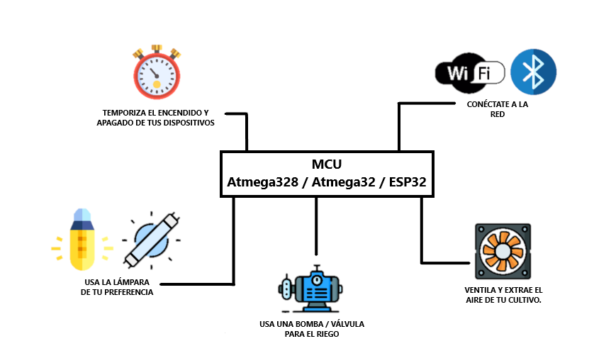
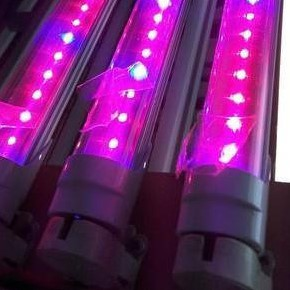
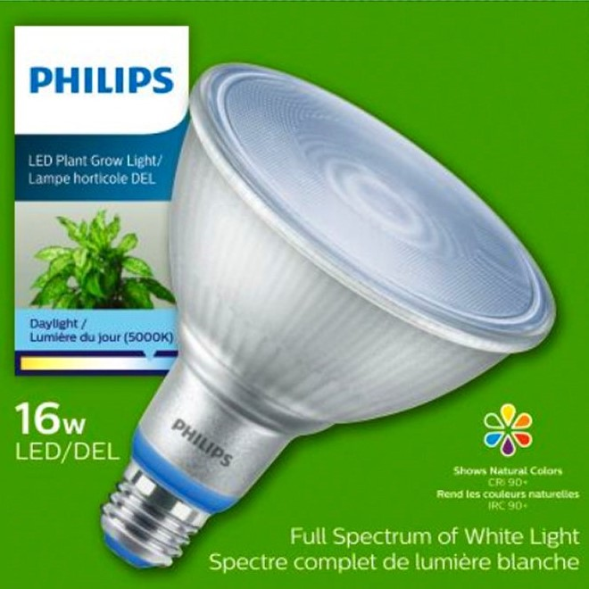
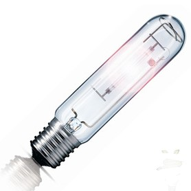
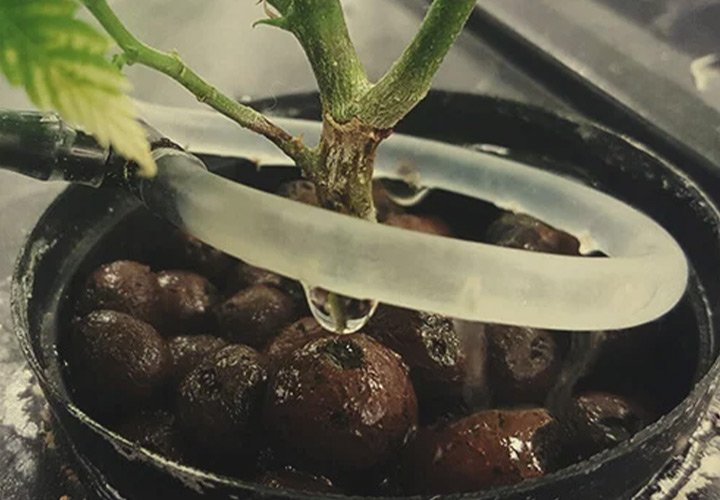
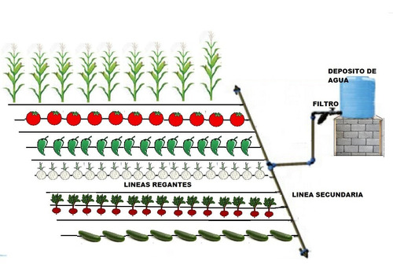
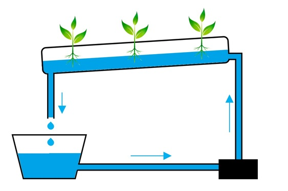
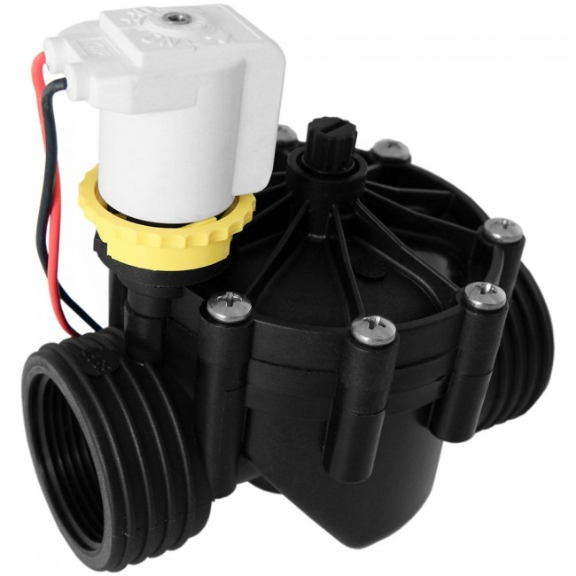

# SmartPlant — IoT Crop Controller

**[Español](README.md)** · **English**

<div align="justify">

**Embedded** controller for growing systems, based on an **ESP32-C3**, designed to automate the switching on and off of lighting, irrigation and ventilation. It is configured from any phone through a **web portal** hosted on the microcontroller itself, with no need to install apps or depend on cloud services or external frameworks.

The project explores how technology can make the local, sustainable production of some vegetables easier in controlled growing spaces, such as greenhouses, gardens and small home setups. The aim is to contribute to the supply of fresh food in small communities and households, prioritizing the species that best suit the conditions of these growing methods.

</div>

<br>
<div align="center">
  
</div>
<br>

`C++` · `ESP32-C3` · `Arduino / ESP-IDF` · `Vanilla JS` · `HTML/CSS` · `mbedTLS (planned)` · `FastAPI + PostgreSQL (in progress)`

---

## CONTENTS

* [WHAT IT CONTROLS AND HOW.](#what-it-controls-and-how)
  - [LIGHTING.](#lighting)
  - [IRRIGATION.](#irrigation)
  - [VENTILATION / EXTRACTION.](#ventilation--extraction)
* [AVAILABLE SETTINGS.](#available-settings)
* [HARDWARE.](#hardware)
* [THE PORTAL.](#the-portal)
* [ARCHITECTURE AT A GLANCE.](#architecture-at-a-glance)
* [PROJECT STATUS.](#project-status)
* [REPOSITORY STRUCTURE.](#repository-structure)
* [DOCUMENTATION.](#documentation)

---

## WHAT IT CONTROLS AND HOW

<div align="justify">

SmartPlant automates the switching on and off of **lighting**, **irrigation** and **ventilation**. Each actuator is driven by the ESP32-C3 firmware and scheduled from a web portal; no internet connection is required to operate.

</div>

#### LIGHTING.

<div align="justify">

The system offers two levels of lighting control:

- Control of **conventional lamps (GPIO 0)**: switches a grow lamp on and off on a programmed schedule (photoperiod, which can cross midnight). This makes it compatible with a wide variety of lamps on the market, such as fluorescent, LED or HPS.
- Independent control of the **blue and red spectra (optional, GPIO 1 and 2)**: for more experienced users, the system can adjust the intensity of the blue and red spectra separately (PWM dimmer), adapting the light to the needs of the crop.

</div>

<br>
<table align="center">
  <tr>
    <th>Red/blue lamps.</th>
    <th>White lamps.</th>
    <th>Other lamps.</th>
  </tr>
</table>
<div align="center">
  &emsp;&emsp;&emsp;&emsp;
  &emsp;&emsp;&emsp;&emsp;
  
</div>
<br>

#### IRRIGATION.

<div align="justify">

Irrigation programming, by switching a **pump or solenoid valve (GPIO 10)** on and off, lets you set two parameters independently:

- **Irrigation frequency:** defines how many times a day the system is activated, with configurable intervals from one hour up to once a week.
- **Irrigation duration:** sets how many minutes the system stays on in each cycle.

Both values are adjusted to the irrigation method (drip, gravity, NFT or sprinkler, among others) and the water needs of the crop, allowing shorter or longer irrigation cycles, with greater or lesser frequency.

</div>

<br>
<table align="center">
  <tr>
    <th>&emsp;Drip.&emsp;</th>
    <th>&emsp;Gravity.&emsp;</th>
    <th>&emsp;NFT method.&emsp;</th>
    <th>&emsp;Solenoid valve.&emsp;</th>
  </tr>
</table>
<div align="center">
  &emsp;&emsp;&emsp;&emsp;
  &emsp;&emsp;&emsp;&emsp;
  &emsp;&emsp;&emsp;&emsp;
  
</div>
<br>

#### VENTILATION / EXTRACTION.

<div align="justify">

Ventilation helps maintain suitable environmental conditions for the crop, since it regulates temperature, renews the air and reduces excess humidity, factors that directly influence plant growth and health. To this end, the system switches a **fan and/or extractor (GPIO 7)** on and off through two configurable parameters:

- **Ventilation frequency:** defines how many times a day the system is activated.
- **Ventilation duration:** sets how long the fan or extractor stays on in each cycle.

Both values are adjusted to the environmental conditions and the needs of the crop, allowing shorter or longer ventilation cycles, with greater or lesser frequency.

</div>

---

## AVAILABLE SETTINGS

<div align="justify">

Everything is adjusted from the portal and **applied live**, without restarting the device. The validation rules are identical in the browser and in the firmware.

</div>

| Parameter | Range / options | Notes |
|-----------|-----------------|-------|
| **Lamp** | ON / OFF | Main lamp (no dimming) |
| **Blue** spectrum *(advanced, optional)* | 0–100 % | Dimmable; 5 % steps |
| **Red** spectrum *(advanced, optional)* | 0–100 % | Dimmable; 5 % steps |
| **Photoperiod** | On and off time | Can cross midnight |
| **Irrigation** — frequency | Up to once a week (`0` = off) | Interval in hours |
| **Irrigation** — duration | 0–59 min per cycle | Must be at least 1 if the frequency is not 0 |
| **Ventilation** — frequency | Up to once a week (`0` = off) | Interval in hours |
| **Ventilation** — duration | 0–59 min per cycle | Must be at least 1 if the frequency is not 0 |
| **Device time** | Date and time | Synced from the browser, kept by an RTC |
| **Master switch** (`enable`) | ON / OFF | Disables the crop |
| **User Wi-Fi network** | SSID + password | Conditional AP+STA; for future cloud/telemetry |

---

## HARDWARE

<div align="justify">

The controller is an **ESP32-C3** (RISC-V, 1 core @160 MHz) with native Wi-Fi, which serves the complete web portal from its own flash.

</div>

| Component | GPIO | Notes |
|-----------|------|-------|
| Lamp | 0 | Digital output (active-low: `LOW` = on) |
| Blue LED | 1 | PWM channel 1 |
| Red LED | 2 | PWM channel 2 |
| Buzzer | 3 | Audible signaling (active-low: `LOW` = sounds) |
| Fan | 7 | Relay (active-low: `LOW` = on) |
| Water pump | 10 | Relay (active-low: `LOW` = on) |
| DS3231 RTC | I²C `0x68` | External clock for scheduling |

<div align="justify">

PWM runs at 1 kHz with 8-bit resolution (0–255); spectrum values travel as 0–100 % and are scaled in the firmware. The full detail — schematics, power stage (MOSFET/relay), RTC and electrical installation — is in **[`docs/HARDWARE.md`](docs/HARDWARE.md)**.

</div>

---

## THE PORTAL

<div align="justify">

When you join the **SmartPlant** network, the operating system detects the captive portal and opens the form automatically. The whole frontend is a single HTML file with vanilla JavaScript served from the microcontroller's flash: no build, no CDN, no dependencies. It is the configuration interface for everything above.

</div>

<br>
<table align="center">
  <tr>
    <th>Dashboard.</th>
    <th>Parameter editing.</th>
    <th>Network setup.</th>
  </tr>
  <tr>
    <td></td>
    <td></td>
    <td></td>
  </tr>
</table>
<br>

<div align="justify">

The dashboard shows the crop state in read-only mode; editing requires authentication, which issues a session token valid for 30 minutes. The network view scans the available signals and connects the device to the user's Wi-Fi without losing access to the portal.

</div>

---

## ARCHITECTURE AT A GLANCE

```
┌──────────────┐   Wi-Fi (WPA2)   ┌─────────────────────────────┐
│  📱 Client    │ ────────────────▶│   ESP32-C3  "SmartPlant"    │
│  (browser)   │   HTTP / JSON    │ ┌─────────────────────────┐ │
└──────────────┘                  │ │ Captive portal (AP)     │ │
                                  │ │ SPA in 1 HTML (vanilla) │ │
                                  │ └─────────────────────────┘ │
   user's network   ◀─────────────│ ┌─────────────────────────┐ │
   (Internet, future)             │ │ STA  (conditional AP+STA)│ │
                                  │ └─────────────────────────┘ │
                                  │  PWM LEDs · Pump · Fan ·    │
                                  │  RTC DS3231 · NVS · Token   │
                                  └─────────────────────────────┘
```

<div align="justify">

The frontend is a **state machine** in a single HTML file; the firmware exposes a JSON API and applies the configuration instantly. All browser↔microcontroller communication happens inside the AP's local network. The details are in [`docs/ARCHITECTURE.md`](docs/ARCHITECTURE.md); the API contract is in [`docs/API.md`](docs/API.md).

</div>

---

## PROJECT STATUS

<div align="justify">

The Arduino firmware is **functional** (portal, scheduling, session, AP+STA Wi-Fi, local OTA, portal security); the backend has **authentication and provisioning** running; backend telemetry and the firmware migration to ESP-IDF are **in progress**, and secure OTA over TLS and temperature/humidity sensing are **planned**.

The detailed status — with the level of evidence for each capability (verified / verified on hardware / written untested / in progress / planned) — is the single source of truth and lives in **[`docs/ROADMAP.md` § Estado actual](docs/ROADMAP.md#estado-actual)** (in Spanish).

</div>

---

## REPOSITORY STRUCTURE

```
.
├── ESP32_controller/   # STABLE firmware (Arduino-ESP32): sketch in production
├── firmware/           # Firmware being MIGRATED to ESP-IDF (only on the esp-idf-migration branch)
├── HTML/               # Portal: source, generated artifacts, scripts and palettes
├── ESP32_Board/        # Board design (KiCad)
├── pythonServer/       # Backend: FastAPI + Alembic + Docker
├── docs/               # Technical documentation (ARCHITECTURE, API, HARDWARE, BACKEND, ROADMAP)
├── README.md
└── README.en.md
```

<div align="justify">

**Two firmware bases.** `ESP32_controller/` is the **stable** firmware (Arduino-ESP32), the one flashed today, on the `main` branch. `firmware/` is the ongoing **migration to ESP-IDF** (only on the `esp-idf-migration` branch), which uses the stable one as its reference specification and will replace it once it reaches parity. The portal, the backend, the hardware and the documentation are **shared** by both: they are edited on `main` and brought to the other branch with `git merge`. The details of this convention and of the workflow are in [`docs/ARCHITECTURE.md`](docs/ARCHITECTURE.md) and [`docs/ROADMAP.md`](docs/ROADMAP.md).

</div>

---

## DOCUMENTATION

<div align="justify">

All the technical documentation lives in **[`docs/`](docs/README.md)** (in Spanish):

- **[docs/ARCHITECTURE.md](docs/ARCHITECTURE.md)** — technical design and **engineering decisions**: trade-offs, portal state machine, portal regeneration convention, DB model and TLS strategy.
- **[docs/API.md](docs/API.md)** — complete HTTP API reference: routes, payloads, validation, errors and `curl` examples.
- **[docs/HARDWARE.md](docs/HARDWARE.md)** — pin map, PWM, RTC, power stage, connectivity and electrical installation.
- **[docs/BACKEND.md](docs/BACKEND.md)** — backend design (FastAPI + Postgres/Timescale + MQTT + S3): data model and API contracts.
- **[docs/ROADMAP.md](docs/ROADMAP.md)** — **project status** (what works today) and the phased plan to migrate the firmware to ESP-IDF.
- **[pythonServer/README.md](pythonServer/README.md)** — how to bring up the local backend.

</div>

---

<div align="center">

**SmartPlant v1.0** · Embedded firmware + captive portal for IoT crop growing

</div>
