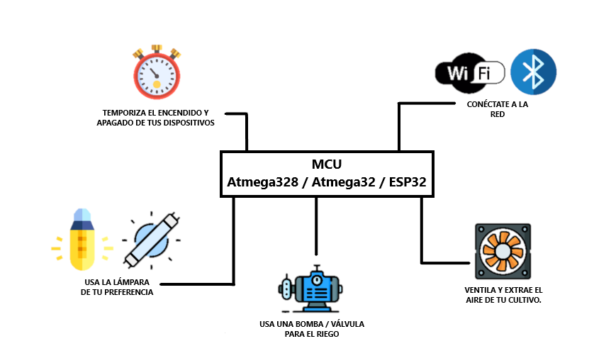
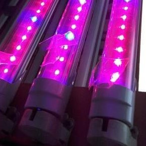
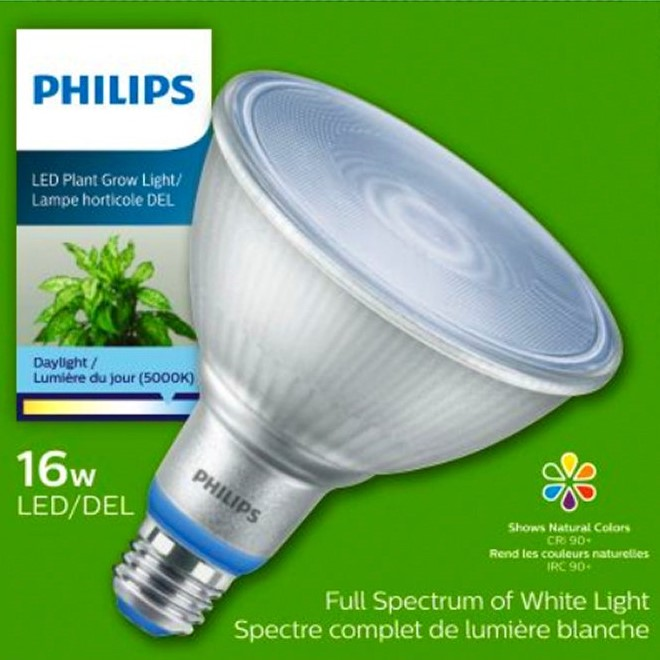
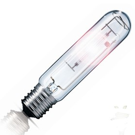
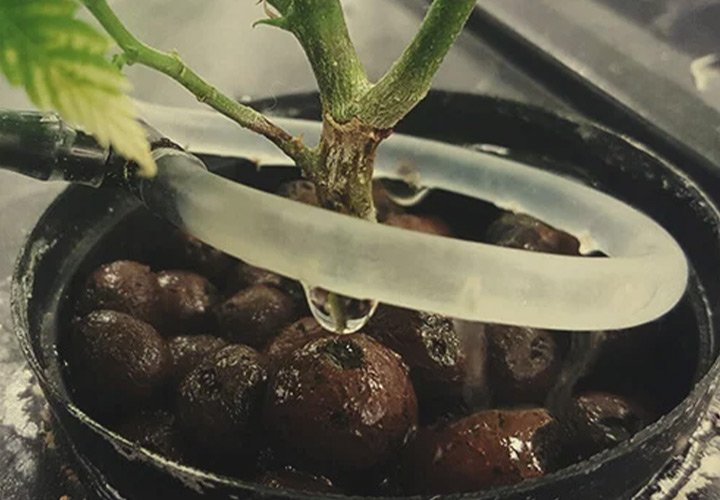
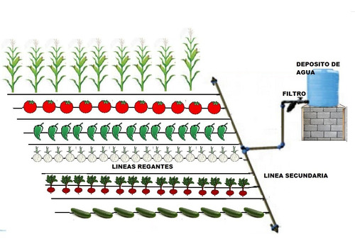
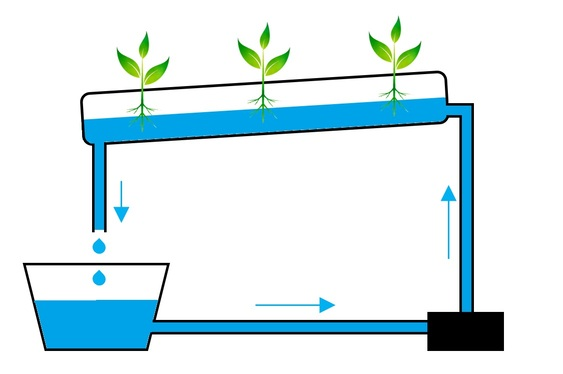
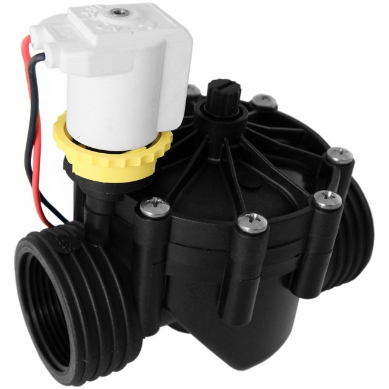

# SmartPlant — Controlador de Cultivo IoT

**Español** · **[English](README.en.md)**

<div align="justify">

Controlador **embebido** para sistemas de cultivo, basado en un **ESP32-C3**, diseñado para automatizar el encendido y apagado de la iluminación, el riego y la ventilación. Su configuración se realiza desde cualquier celular mediante un **portal web** alojado en el propio microcontrolador, sin necesidad de instalar aplicaciones ni depender de servicios en la nube o frameworks externos.

El proyecto busca explorar cómo la tecnología puede facilitar la producción local y sustentable de algunas hortalizas en espacios de cultivo controlado, como invernaderos, huertos y pequeñas instalaciones domésticas. La intención es poder contribuir al abastecimiento de alimentos frescos en pequeñas comunidades y hogares, priorizando aquellas especies que mejor se adapten a las condiciones de estos métodos de cultivo.

</div>

<br>
<div align="center">
  
</div>
<br>

`C++` · `ESP32-C3` · `Arduino / ESP-IDF` · `Vanilla JS` · `HTML/CSS` · `mbedTLS (planned)` · `FastAPI + PostgreSQL (in progress)`

---

## CONTENIDO

* [QUÉ CONTROLA Y CÓMO.](#qué-controla-y-cómo)
  - [ILUMINACIÓN.](#iluminación)
  - [RIEGO.](#riego)
  - [VENTILACIÓN / EXTRACCIÓN.](#ventilación--extracción)
* [CONFIGURACIÓN DISPONIBLE.](#configuración-disponible)
* [HARDWARE.](#hardware)
* [EL PORTAL.](#el-portal)
* [ARQUITECTURA EN UNA VISTA.](#arquitectura-en-una-vista)
* [ESTADO DEL PROYECTO.](#estado-del-proyecto)
* [ESTRUCTURA DEL REPOSITORIO.](#estructura-del-repositorio)
* [DOCUMENTACIÓN.](#documentación)

---

## QUÉ CONTROLA Y CÓMO

<div align="justify">

SmartPlant automatiza el encendido y apagado de la **iluminación**, el **riego** y la **ventilación**. Cada actuador se maneja desde el firmware del ESP32-C3 y se programa desde un portal web; no se requiere internet para operar.

</div>

#### ILUMINACIÓN.

<div align="justify">

El sistema ofrece dos niveles de control de iluminación:

- Control de **lámparas convencionales (GPIO 0)**: permite encender y apagar una lámpara de cultivo mediante un horario programado (fotoperiodo, que admite cruzar la medianoche). Esto lo hace compatible con una gran variedad de lámparas disponibles en el mercado, ya sean, fluorescentes, LED, HPS, etc.
- Control independiente de **espectros azul y rojo (opcional, GPIO 1 y 2)**: para quienes tengan mayor experiencia, el sistema permite regular por separado la intensidad de los espectros azul y rojo (dimmer por PWM), adaptando la luz a las necesidades del cultivo.

</div>

<br>
<table align="center">
  <tr>
    <th>Lámparas rojo/azul.</th>
    <th>Lámparas blancas.</th>
    <th>Otras lámparas.</th>
  </tr>
</table>
<div align="center">
  &emsp;&emsp;&emsp;&emsp;
  &emsp;&emsp;&emsp;&emsp;
  
</div>
<br>

#### RIEGO.

<div align="justify">

La programación del riego mediante el encendido y apagado de una **bomba o electroválvula (GPIO 10)** permite configurar de forma independiente dos parámetros:

- **Frecuencia de riego:** define cuántas veces al día se activa el sistema, con intervalos configurables desde una hora hasta una vez por semana.
- **Duración del riego:** establece cuántos minutos permanece activo el sistema en cada ciclo.

Ambos valores se ajustan según el método de riego (goteo, gravedad, NFT o aspersión, entre otros) y las necesidades hídricas del cultivo, permitiendo establecer ciclos de riego más cortos o prolongados, con mayor o menor frecuencia.

</div>

<br>
<table align="center">
  <tr>
    <th>&emsp;Goteo.&emsp;</th>
    <th>&emsp;Gravedad.&emsp;</th>
    <th>&emsp;Método NFT.&emsp;</th>
    <th>&emsp;Válvula E.&emsp;</th>
  </tr>
</table>
<div align="center">
  &emsp;&emsp;&emsp;&emsp;
  &emsp;&emsp;&emsp;&emsp;
  &emsp;&emsp;&emsp;&emsp;
  
</div>
<br>

#### VENTILACIÓN / EXTRACCIÓN.

<div align="justify">

La ventilación contribuye a mantener condiciones ambientales adecuadas para el cultivo, ya que permite regular la temperatura, renovar el aire y reducir el exceso de humedad, factores que influyen directamente en el crecimiento y la salud de las plantas. Para ello, el sistema controla el encendido y apagado de un **ventilador y/o extractor (GPIO 7)** mediante dos parámetros configurables:

- **Frecuencia de ventilación:** define cuántas veces al día se activa el sistema.
- **Duración de la ventilación:** establece cuánto tiempo permanece encendido el ventilador o extractor en cada ciclo.

Ambos valores se ajustan según las condiciones ambientales y las necesidades del cultivo, permitiendo establecer ciclos de ventilación más cortos o prolongados, con mayor o menor frecuencia.

</div>

---

## CONFIGURACIÓN DISPONIBLE

<div align="justify">

Todo se ajusta desde el portal y se **aplica en vivo**, sin reiniciar el dispositivo. Las reglas de validación son idénticas en el navegador y en el firmware.

</div>

| Parámetro | Rango / opciones | Notas |
|-----------|------------------|-------|
| **Lámpara** | ON / OFF | Lámpara principal (sin regulación) |
| Espectro **azul** *(avanzado, opcional)* | 0–100 % | Dimmeable; intervalos de 5% |
| Espectro **rojo** *(avanzado, opcional)* | 0–100 % | Dimmeable; intervalos de 5% |
| **Fotoperiodo** | Hora de encendido y apagado | Admite cruce de medianoche |
| **Riego** — frecuencia | Hasta una vez por semana (`0` = apagado) | Intervalo en horas |
| **Riego** — duración | 0–59 min por ciclo | Debe ser al menos 1 si la frecuencia no es 0 |
| **Ventilación** — frecuencia | Hasta una vez por semana (`0` = apagado) | Intervalo en horas |
| **Ventilación** — duración | 0–59 min por ciclo | Debe ser al menos 1 si la frecuencia no es 0 |
| **Hora del dispositivo** | Fecha y hora | Se sincroniza desde el navegador, se mantiene con un RTC |
| **Interruptor general** (`enable`) | ON / OFF | Desactiva el cultivo |
| **Red Wi-Fi del usuario** | SSID + contraseña | AP+STA condicional; para nube/telemetría a futuro |

---

## HARDWARE

<div align="justify">

El controlador es un **ESP32-C3** (RISC-V, 1 núcleo @160 MHz) con Wi-Fi nativo, que sirve el portal web completo desde su propia flash.

</div>

| Componente | GPIO | Notas |
|-----------|------|-------|
| Lámpara | 0 | Salida digital (activa en bajo: `LOW` = encendido) |
| LED azul | 1 | PWM canal 1 |
| LED rojo | 2 | PWM canal 2 |
| Buzzer | 3 | Señalización sonora (activo en bajo: `LOW` = suena) |
| Ventilador | 7 | Relé (activo en bajo: `LOW` = encendido) |
| Bomba de agua | 10 | Relé (activo en bajo: `LOW` = encendido) |
| RTC DS3231 | I²C `0x68` | Reloj externo para scheduling |

<div align="justify">

PWM a 1 kHz con resolución de 8 bits (0–255); los valores de espectro viajan como 0–100 % y se escalan en el firmware. El detalle completo —esquemáticos, etapa de potencia (MOSFET/relé), RTC e instalación eléctrica— está en **[`docs/HARDWARE.md`](docs/HARDWARE.md)**.

</div>

---

## EL PORTAL

<div align="justify">

Al conectarse a la red **SmartPlant**, el sistema operativo detecta el portal captivo y abre el formulario automáticamente. Todo el frontend es un único archivo HTML con JavaScript vanilla servido desde el flash del microcontrolador: sin build, sin CDN, sin dependencias. Es la interfaz de configuración de todo lo anterior.

</div>

<br>
<table align="center">
  <tr>
    <th>Dashboard.</th>
    <th>Edición de parámetros.</th>
    <th>Configuración de red.</th>
  </tr>
  <tr>
    <td></td>
    <td></td>
    <td></td>
  </tr>
</table>
<br>

<div align="justify">

El dashboard muestra el estado del cultivo en modo lectura; para editar hay que autenticarse, lo que emite un token de sesión válido 30 minutos. La vista de red escanea las señales disponibles y conecta el dispositivo a la Wi-Fi del usuario sin perder el acceso al portal.

</div>

---

## ARQUITECTURA EN UNA VISTA

```
┌──────────────┐   Wi-Fi (WPA2)   ┌─────────────────────────────┐
│  📱 Cliente   │ ────────────────▶│   ESP32-C3  "SmartPlant"    │
│ (navegador)  │   HTTP / JSON    │ ┌─────────────────────────┐ │
└──────────────┘                  │ │ Portal captivo (AP)     │ │
                                  │ │ SPA en 1 HTML (vanilla) │ │
                                  │ └─────────────────────────┘ │
   red del usuario   ◀────────────│ ┌─────────────────────────┐ │
   (Internet, futuro)             │ │ STA  (AP+STA condicional)│ │
                                  │ └─────────────────────────┘ │
                                  │  PWM LEDs · Bomba · Fan ·   │
                                  │  RTC DS3231 · NVS · Token   │
                                  └─────────────────────────────┘
```

<div align="justify">

El frontend es una **máquina de estados** en un único HTML; el firmware expone una API JSON y aplica la configuración al instante. Toda la comunicación navegador↔microcontrolador ocurre dentro de la red local del AP. El detalle está en [`docs/ARCHITECTURE.md`](docs/ARCHITECTURE.md); el contrato de la API, en [`docs/API.md`](docs/API.md).

</div>

---

## ESTADO DEL PROYECTO

<div align="justify">

El firmware Arduino es **funcional** (portal, scheduling, sesión, Wi-Fi AP+STA, OTA local, seguridad del portal); el backend tiene **autenticación y provisión** corriendo; están **en curso** la telemetría del backend y la migración del firmware a ESP-IDF, y **planeados** la OTA segura sobre TLS y la medición de temperatura/humedad.

El estado detallado —con nivel de evidencia por capacidad (verificado / verificado en hardware / escrito sin probar / en curso / planeado)— es la única fuente de verdad y vive en **[`docs/ROADMAP.md` § Estado actual](docs/ROADMAP.md#estado-actual)**.

</div>

---

## ESTRUCTURA DEL REPOSITORIO

```
.
├── ESP32_controller/   # Firmware ESTABLE (Arduino-ESP32): sketch en producción
├── firmware/           # Firmware en MIGRACIÓN a ESP-IDF (solo en la rama esp-idf-migration)
├── HTML/               # Portal: fuente, artefactos generados, scripts y paletas
├── ESP32_Board/        # Diseño de la tarjeta (KiCad)
├── pythonServer/       # Backend: FastAPI + Alembic + Docker
├── docs/               # Documentación técnica (ARCHITECTURE, API, HARDWARE, BACKEND, ROADMAP)
├── README.md
└── README.en.md
```

<div align="justify">

**Dos bases de firmware.** `ESP32_controller/` es el firmware **estable** (Arduino-ESP32), el que se flashea hoy, en la rama `main`. `firmware/` es la **migración a ESP-IDF** en curso (solo en la rama `esp-idf-migration`), que usa el estable como especificación de referencia y lo reemplazará al alcanzar paridad. El portal, el backend, el hardware y la documentación son **comunes** a ambas: se editan en `main` y se llevan a la otra rama con `git merge`. El detalle de esta convención y del flujo de trabajo está en [`docs/ARCHITECTURE.md`](docs/ARCHITECTURE.md) y [`docs/ROADMAP.md`](docs/ROADMAP.md).

</div>

---

## DOCUMENTACIÓN

<div align="justify">

Toda la documentación técnica vive en **[`docs/`](docs/README.md)**:

- **[docs/ARCHITECTURE.md](docs/ARCHITECTURE.md)** — diseño técnico y **decisiones de ingeniería**: trade-offs, máquina de estados del portal, convención de regeneración del portal, modelo de BD y estrategia TLS.
- **[docs/API.md](docs/API.md)** — referencia completa de la API HTTP: rutas, payloads, validaciones, errores y ejemplos con `curl`.
- **[docs/HARDWARE.md](docs/HARDWARE.md)** — mapa de pines, PWM, RTC, etapa de potencia, conectividad e instalación eléctrica.
- **[docs/BACKEND.md](docs/BACKEND.md)** — diseño del backend (FastAPI + Postgres/Timescale + MQTT + S3): modelo de datos y contratos de API.
- **[docs/ROADMAP.md](docs/ROADMAP.md)** — **estado del proyecto** (qué funciona hoy) y plan de migración del firmware a ESP-IDF por fases.
- **[pythonServer/README.md](pythonServer/README.md)** — cómo levantar el backend local.

</div>

---

<div align="center">

**SmartPlant v1.0** · Firmware embebido + portal captivo para cultivo IoT

</div>
