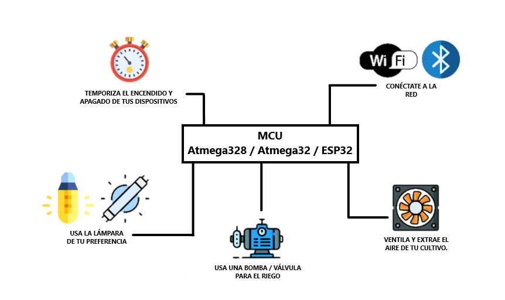
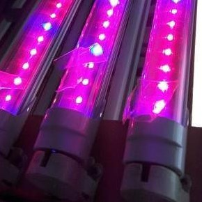
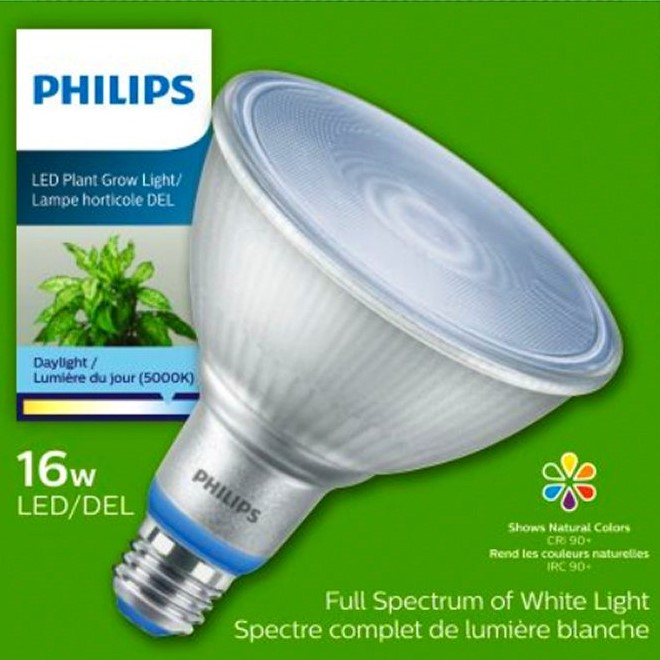
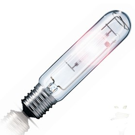
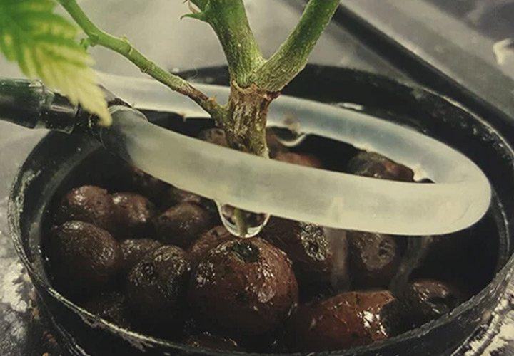
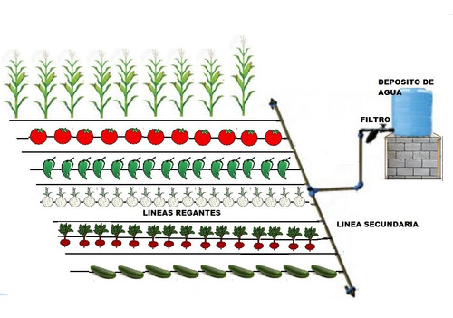
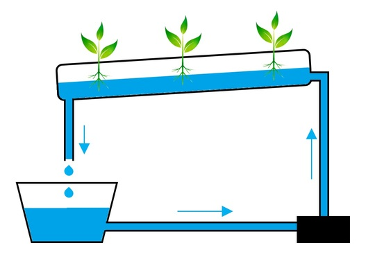
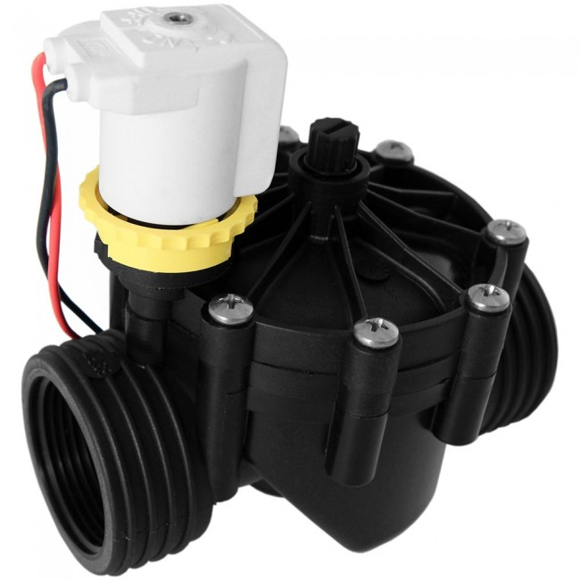

# SmartPlant — Controlador de Cultivo IoT

<div align="justify">

Controlador **embebido** para cultivo indoor sobre **ESP32-C3**: regula iluminación por espectro, riego y ventilación, y se configura desde el celular mediante un portal Wi-Fi servido por el propio microcontrolador — sin app, sin nube obligatoria, sin frameworks de terceros. Nace con una motivación de fondo: avanzar hacia la **independencia alimentaria** con hortalizas adaptables a cultivo protegido.

</div>

<br>
<div align="center">
  
</div>
<br>

`C++` · `ESP32-C3` · `Arduino / ESP-IDF` · `Vanilla JS` · `HTML/CSS` · `mbedTLS (planned)` · `FastAPI + PostgreSQL (in progress)`

---

## CONTENIDO

* [QUÉ CONTROLA Y CÓMO.](#qué-controla-y-cómo)
  - [ILUMINACIÓN.](#iluminación)
  - [RIEGO.](#riego)
  - [VENTILACIÓN / EXTRACCIÓN.](#ventilación--extracción)
* [CONFIGURACIÓN DISPONIBLE.](#configuración-disponible)
* [HARDWARE.](#hardware)
* [EL PORTAL.](#el-portal)
* [ARQUITECTURA EN UNA VISTA.](#arquitectura-en-una-vista)
* [CÓMO ESTÁ CONSTRUIDO.](#cómo-está-construido)
* [COMPILAR Y USAR.](#compilar-y-usar)
* [ESTADO DEL PROYECTO.](#estado-del-proyecto)
* [ESTRUCTURA DEL REPOSITORIO.](#estructura-del-repositorio)
* [DOCUMENTACIÓN.](#documentación)

---

## QUÉ CONTROLA Y CÓMO

<div align="justify">

SmartPlant automatiza las tres tareas básicas de un cultivo protegido: **luz, riego y aire**. Cada actuador se maneja desde el firmware del ESP32-C3 y se programa desde el portal web; no se requiere internet para operar.

</div>

#### ILUMINACIÓN.

<div align="justify">

El sistema ofrece dos niveles de control de iluminación:

- **Control de lámparas convencionales (GPIO 0):** permite encender y apagar una lámpara de cultivo mediante un horario programado (fotoperiodo, que admite cruzar la medianoche). Esto lo hace compatible con una gran variedad de lámparas disponibles en el mercado, sin necesidad de que tengan regulación de intensidad.
- **Control independiente de espectros azul y rojo (opcional, GPIO 1 y 2):** para quienes buscan un mayor control sobre la iluminación, el sistema permite regular por separado la intensidad de los espectros azul y rojo (dimmer por PWM), adaptando la luz a las necesidades del cultivo.

</div>

<br>
<table align="center">
  <tr>
    <th>Lámparas rojo/azul.</th>
    <th>Lámparas blancas.</th>
    <th>Otras lámparas.</th>
  </tr>
</table>
<div align="center">
  &emsp;&emsp;&emsp;&emsp;
  &emsp;&emsp;&emsp;&emsp;
  
</div>
<br>

#### RIEGO.

<div align="justify">

El sistema permite automatizar el riego mediante el encendido y apagado de una bomba o electroválvula, por lo que puede adaptarse a distintos métodos de riego, como goteo, gravedad, NFT o aspersión.

La programación es flexible y permite ajustar dos aspectos de forma independiente:

- **Frecuencia de riego:** define cada cuánto tiempo se activa el riego, desde intervalos de una hora hasta una vez por semana.
- **Duración del riego:** establece cuántos minutos permanece activo el sistema en cada ciclo.

Esta flexibilidad permite adaptar el funcionamiento a las características de cada instalación y a las necesidades del cultivo. Por ejemplo, un sistema con una bomba de alto caudal puede requerir riegos más cortos y espaciados, mientras que uno de goteo con menor caudal puede necesitar riegos más frecuentes.

</div>

<br>
<table align="center">
  <tr>
    <th>&emsp;Goteo.&emsp;</th>
    <th>&emsp;Gravedad.&emsp;</th>
    <th>&emsp;Método NFT.&emsp;</th>
    <th>&emsp;Válvula E.&emsp;</th>
  </tr>
</table>
<div align="center">
  &emsp;&emsp;&emsp;&emsp;
  &emsp;&emsp;&emsp;&emsp;
  &emsp;&emsp;&emsp;&emsp;
  
</div>
<br>

#### VENTILACIÓN / EXTRACCIÓN.

<div align="justify">

La calidad del aire influye en la temperatura y, por lo tanto, en el desarrollo del cultivo. El sistema controla un **relé** (lógica directa) para activar un ventilador o extractor en **intervalos configurables**, forzando la circulación de aire limpio y la salida del aire viciado.

</div>

---

## CONFIGURACIÓN DISPONIBLE

<div align="justify">

Todo se ajusta desde el portal y se **aplica en vivo**, sin reiniciar el dispositivo. Las reglas de validación son idénticas en el navegador y en el firmware.

</div>

| Parámetro | Rango / opciones | Notas |
|-----------|------------------|-------|
| **Lámpara** | ON / OFF | Control principal de iluminación; canal digital (sin regulación) |
| Espectro **azul** *(avanzado, opcional)* | 0–100 % | PWM; se escala a 0–255 en el firmware |
| Espectro **rojo** *(avanzado, opcional)* | 0–100 % | PWM; se escala a 0–255 en el firmware |
| **Fotoperiodo** | Hora de encendido y apagado | Admite cruce de medianoche |
| **Riego** — frecuencia | De cada hora a una vez por semana (`0` = apagado) | Intervalo en horas; scheduling desde el RTC |
| **Riego** — duración | Minutos por ciclo | — |
| **Ventilación** — frecuencia | De cada hora a una vez por semana (`0` = apagado) | Intervalo en horas |
| **Ventilación** — duración | Minutos por ciclo | — |
| **Hora del dispositivo** | Fecha y hora | Se sincroniza desde el navegador al RTC DS3231 |
| **Interruptor general** (`enable`) | ON / OFF | OFF inhibe todos los actuadores |
| **Red Wi-Fi del usuario** | SSID + contraseña | AP+STA condicional; para nube/telemetría a futuro |

<div align="justify">

El rango y las opciones exactas (incluidas las frecuencias válidas) salen de `Constants.h`; el contrato completo de cada parámetro está en [`docs/API.md`](docs/API.md).

</div>

---

## HARDWARE

<div align="justify">

El controlador es un **ESP32-C3** (RISC-V, 1 núcleo @160 MHz) con Wi-Fi nativo, que sirve el portal web completo desde su propia flash.

</div>

| Componente | GPIO | Notas |
|-----------|------|-------|
| Lámpara | 0 | Salida digital (lógica directa) |
| LED azul | 1 | PWM canal 1 |
| LED rojo | 2 | PWM canal 2 |
| Buzzer | 3 | Señalización sonora |
| Ventilador | 7 | Relé (lógica directa) |
| Bomba de agua | 10 | Relé (lógica directa) |
| RTC DS3231 | I²C `0x68` | Reloj externo para scheduling |

<div align="justify">

PWM a 1 kHz con resolución de 8 bits (0–255); los valores de espectro viajan como 0–100 % y se escalan en el firmware. El detalle completo —esquemáticos, etapa de potencia (MOSFET/relé), RTC e instalación eléctrica— está en **[`docs/HARDWARE.md`](docs/HARDWARE.md)**.

</div>

---

## EL PORTAL

<div align="justify">

Al conectarse a la red **SmartPlant**, el sistema operativo detecta el portal captivo y abre el formulario automáticamente. Todo el frontend es un único archivo HTML con JavaScript vanilla servido desde el flash del microcontrolador: sin build, sin CDN, sin dependencias. Es la interfaz de configuración de todo lo anterior.

</div>

<br>
<table align="center">
  <tr>
    <th>Dashboard.</th>
    <th>Edición de parámetros.</th>
    <th>Configuración de red.</th>
  </tr>
  <tr>
    <td></td>
    <td></td>
    <td></td>
  </tr>
</table>
<br>

<div align="justify">

El dashboard muestra el estado del cultivo en modo lectura; para editar hay que autenticarse, lo que emite un token de sesión válido 30 minutos. La vista de red escanea las señales disponibles y conecta el dispositivo a la Wi-Fi del usuario sin perder el acceso al portal.

</div>

---

## ARQUITECTURA EN UNA VISTA

```
┌──────────────┐   Wi-Fi (WPA2)   ┌─────────────────────────────┐
│  📱 Cliente   │ ────────────────▶│   ESP32-C3  "SmartPlant"    │
│ (navegador)  │   HTTP / JSON    │ ┌─────────────────────────┐ │
└──────────────┘                  │ │ Portal captivo (AP)     │ │
                                  │ │ SPA en 1 HTML (vanilla) │ │
                                  │ └─────────────────────────┘ │
   red del usuario   ◀────────────│ ┌─────────────────────────┐ │
   (Internet, futuro)             │ │ STA  (AP+STA condicional)│ │
                                  │ └─────────────────────────┘ │
                                  │  PWM LEDs · Bomba · Fan ·   │
                                  │  RTC DS3231 · NVS · Token   │
                                  └─────────────────────────────┘
```

<div align="justify">

El frontend es una **máquina de estados** en un único HTML; el firmware expone una API JSON y aplica la configuración al instante. Toda la comunicación navegador↔microcontrolador ocurre dentro de la red local del AP. El detalle está en [`docs/ARCHITECTURE.md`](docs/ARCHITECTURE.md); el contrato de la API, en [`docs/API.md`](docs/API.md).

</div>

---

## CÓMO ESTÁ CONSTRUIDO

<div align="justify">

Lo interesante de un proyecto embebido no es solo *qué* hace, sino *cómo* resuelve los problemas que impone el hardware (1 núcleo RISC-V @160 MHz, RAM y flash limitadas):

- **Scheduling stateless** del riego, recalculado desde el RTC: sobrevive cortes de luz sin persistir contadores.
- **Servir el portal sin agotar el heap**: HTML comprimido con gzip (−83 %) entregado directo desde flash.
- **Sesión con token** de 128 bits en RAM y **validación idéntica** front↔firmware (por carácter UTF-8).
- **Seguridad por capas**: PBKDF2 para la contraseña, reset restringido al AP y límite de intentos de login.

El razonamiento completo de cada decisión, con sus trade-offs, está en **[`docs/ARCHITECTURE.md` § Decisiones de ingeniería](docs/ARCHITECTURE.md#decisiones-de-ingeniería-resumen)**.

</div>

---

## COMPILAR Y USAR

```bash
# Requisitos: Arduino IDE / arduino-cli con el core ESP32 y ArduinoJson (v6).
# 1. Crear sensible.h con las credenciales del AP (ver plantilla en el código).
# 2. Compilar y flashear el sketch ESP32_controller/ a la placa ESP32-C3.
# 3. Conectarse a la red Wi-Fi "SmartPlant" → el portal captivo abre el formulario.
```

<div align="justify">

No hay test runner automatizado: la validación se hace en hardware. El JS del portal se verifica con `node --check` tras regenerar `mainForm.h` desde el HTML fuente. La convención de regeneración del portal (fuente → artefacto) está en [`docs/ARCHITECTURE.md`](docs/ARCHITECTURE.md).

</div>

---

## ESTADO DEL PROYECTO

<div align="justify">

El firmware Arduino es **funcional** (portal, scheduling, sesión, Wi-Fi AP+STA, OTA local, seguridad del portal); el backend tiene **autenticación y provisión** corriendo; están **en curso** la telemetría del backend y la migración del firmware a ESP-IDF, y **planeados** la OTA segura sobre TLS y la medición de temperatura/humedad.

El estado detallado —con nivel de evidencia por capacidad (verificado / verificado en hardware / escrito sin probar / en curso / planeado)— es la única fuente de verdad y vive en **[`docs/ROADMAP.md` § Estado actual](docs/ROADMAP.md#estado-actual)**.

</div>

---

## ESTRUCTURA DEL REPOSITORIO

```
.
├── ESP32_controller/   # Firmware ESTABLE (Arduino-ESP32): sketch en producción
├── firmware/           # Firmware en MIGRACIÓN a ESP-IDF (solo en la rama esp-idf-migration)
├── HTML/               # Portal: fuente, artefactos generados, scripts y paletas
├── ESP32_Board/        # Diseño de la tarjeta (KiCad)
├── pythonServer/       # Backend: FastAPI + Alembic + Docker
├── docs/               # Documentación técnica (ARCHITECTURE, API, HARDWARE, BACKEND, ROADMAP)
├── README.md
└── README.en.md
```

<div align="justify">

**Dos bases de firmware.** `ESP32_controller/` es el firmware **estable** (Arduino-ESP32), el que se flashea hoy, en la rama `main`. `firmware/` es la **migración a ESP-IDF** en curso (solo en la rama `esp-idf-migration`), que usa el estable como especificación de referencia y lo reemplazará al alcanzar paridad. El portal, el backend, el hardware y la documentación son **comunes** a ambas: se editan en `main` y se llevan a la otra rama con `git merge`. El detalle de esta convención y del flujo de trabajo está en [`docs/ARCHITECTURE.md`](docs/ARCHITECTURE.md) y [`docs/ROADMAP.md`](docs/ROADMAP.md).

</div>

---

## DOCUMENTACIÓN

<div align="justify">

Toda la documentación técnica vive en **[`docs/`](docs/README.md)**:

- **[docs/ARCHITECTURE.md](docs/ARCHITECTURE.md)** — diseño técnico y **decisiones de ingeniería**: trade-offs, máquina de estados del portal, convención de regeneración del portal, modelo de BD y estrategia TLS.
- **[docs/API.md](docs/API.md)** — referencia completa de la API HTTP: rutas, payloads, validaciones, errores y ejemplos con `curl`.
- **[docs/HARDWARE.md](docs/HARDWARE.md)** — mapa de pines, PWM, RTC, etapa de potencia, conectividad e instalación eléctrica.
- **[docs/BACKEND.md](docs/BACKEND.md)** — diseño del backend (FastAPI + Postgres/Timescale + MQTT + S3): modelo de datos y contratos de API.
- **[docs/ROADMAP.md](docs/ROADMAP.md)** — **estado del proyecto** (qué funciona hoy) y plan de migración del firmware a ESP-IDF por fases.
- **[pythonServer/README.md](pythonServer/README.md)** — cómo levantar el backend local.

</div>

---

<div align="center">

**SmartPlant v1.0** · Firmware embebido + portal captivo para cultivo IoT

</div>
