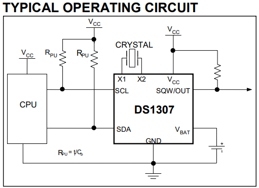
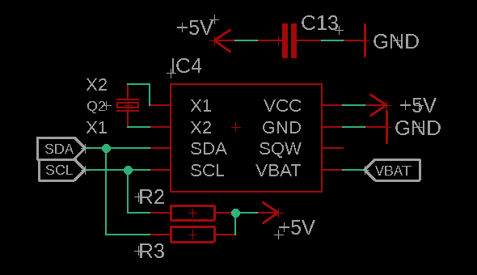
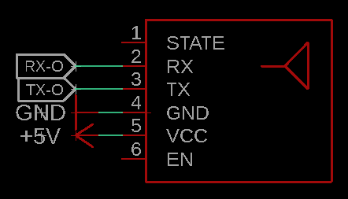
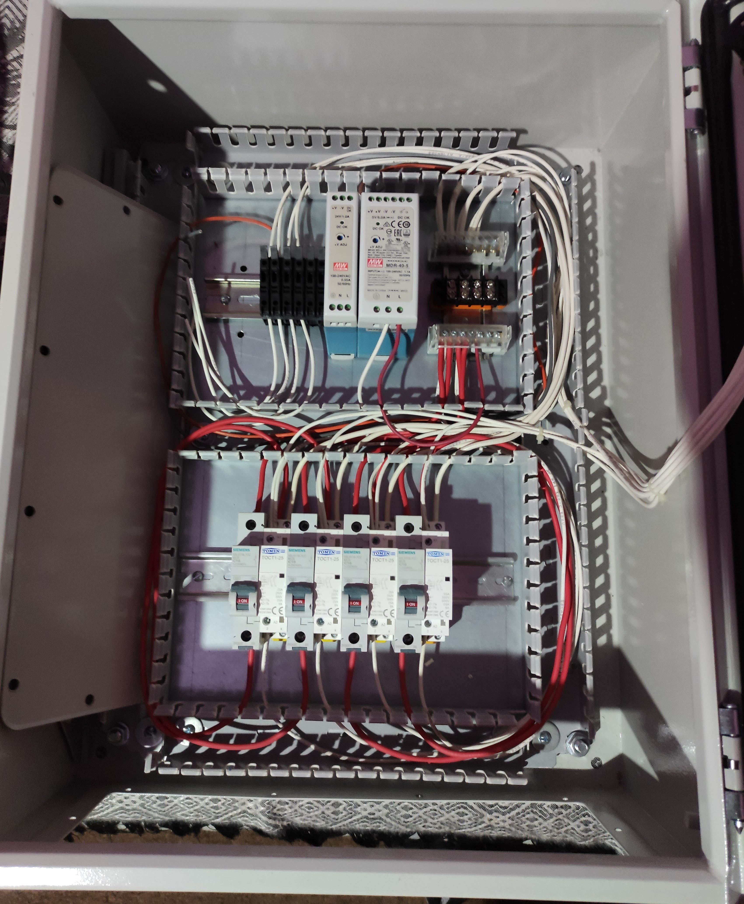

# Hardware

Tarjeta de control, mapa de pines, periféricos y instalación eléctrica.

El controlador es un **ESP32-C3** (RISC-V, 1 núcleo @160 MHz) con Wi-Fi nativo, que sirve el portal captivo desde su propia flash. El diseño eléctrico de potencia (MOSFET, contactores, gabinete) conmuta las cargas en CA.

---

## Contenido

- [Mapa de pines (ESP32-C3)](#mapa-de-pines-esp32-c3)
- [Control de potencia PWM](#control-de-potencia-pwm)
- [Temporización con RTC](#temporización-con-rtc)
- [Etapa de potencia: acoplamiento control ↔ potencia](#etapa-de-potencia-acoplamiento-control--potencia)
- [Conectividad](#conectividad)
- [Instalación eléctrica](#instalación-eléctrica)
- [Medición de temperatura (DS18B20)](#medición-de-temperatura-ds18b20)

---

## Mapa de pines (ESP32-C3)

Definido en `ESP32_controller/Constants.h`.

| Componente | GPIO | Tipo | Notas |
|---|---|---|---|
| LED blanco | 0 | Digital | Lógica directa (`HIGH` = encendido) |
| LED azul | 1 | PWM canal 1 | 0–100 % desde el portal |
| LED rojo | 2 | PWM canal 2 | 0–100 % desde el portal |
| Buzzer | 3 | Digital | Señalización sonora no bloqueante (ver [vocabulario de pitidos](#vocabulario-de-pitidos)) |
| Ventilador / extractor | 7 | Contactor | Lógica directa (MOSFET → bobina de contactor) |
| Bomba de agua | 10 | Contactor | Lógica directa (MOSFET → bobina de contactor) |
| I²C SDA | 8 | I²C | Datos del bus I²C (DS3231) |
| I²C SCL | 9 | I²C | Reloj del bus I²C (DS3231) |
| RTC DS3231 | I²C `0x68` | — | Reloj externo para el scheduling (bus I²C en GPIO 8/9) |

**Polaridad centralizada:** el nivel que enciende vive en **un solo sitio**, las constantes `deviceOn`/`deviceOff` de `Constants.h`, hoy `HIGH`/`LOW` (lógica directa). Si se cambia a módulos de relé activos en bajo, basta intercambiar esas dos líneas y todo el firmware queda coherente.

**Estado inicial seguro:** `Plant::begin()` llama a `allDevicesOff()` antes de leer cualquier configuración, para que ningún actuador arranque energizado.

**La inicialización de hardware NO va en el constructor:** `Plant planta;` es un objeto global, así que su constructor corre durante la inicialización estática de C++, antes de que el framework de Arduino termine de preparar los periféricos. Configurar GPIO o LEDC ahí puede fallar en silencio o quedar sobrescrito, dejando un pin como entrada flotante en lugar de salida firme; el síntoma típico es un relé o LED con **brillo débil** que no conmuta bien. Por eso `pinMode`, `ledcAttachChannel` y el estado inicial se hacen en `begin()`, invocado desde `setup()`.

**Un solo canal digital para el blanco:** el blanco no tiene PWM asignado, así que solo admite ON/OFF. El portal envía `0` o `1` y el firmware evalúa `> 0`. Los espectros azul y rojo sí son regulables, que es donde la granularidad importa para el PAR.

---

## Control de potencia PWM

La modulación por ancho de pulso se usa aquí para regular la intensidad de cada canal LED de forma independiente, permitiendo adaptar el espectro a la etapa del cultivo — más azul en vegetativo, más rojo en floración.

| Parámetro | Valor |
|---|---|
| Frecuencia | 1 kHz |
| Resolución | 8 bits (duty 0–255) |
| Canales | 2 (azul, rojo) |

Los valores viajan del portal al firmware como **porcentaje 0–100** y se escalan internamente con `map(valor, 0, 100, 0, 255)`. Se eligió exponer porcentaje en la API para que el contrato no dependa de la resolución del PWM: si se sube a 10 bits, el frontend no cambia.

---

## Temporización con RTC

Para temporizar el encendido y apagado de los equipos se usa un **DS3231** por I²C (dirección `0x68`), compensado por temperatura y de baja deriva.

El firmware lee el RTC una vez por segundo desde `loop()` (único punto de I²C periódico, para no compartir el bus `Wire` con otras tareas) y con esa lectura decide qué salidas deben estar activas.

La hora **no** se configura con botones: se sincroniza desde el navegador del usuario en el `POST /newparams`, que incluye fecha y hora completas. El primer `/newparams` con fecha válida ancla `cropStart` en NVS, y a partir de ahí la edad del cultivo se **deriva** del calendario en vez de contarse, de modo que el cultivo sigue envejeciendo aunque el equipo estuviera apagado.

<table align="center">
  <tr>
    <th>Diagrama típico de conexión.</th>
    <th>Diagrama de conexión final.</th>
  </tr>
  <tr>
    <th></th>
    <th></th>
  </tr>
</table>

---

## Etapa de potencia: acoplamiento control ↔ potencia

Cómo se acopla la lógica del ESP32-C3 (3.3 V) con la potencia. Esta sección recoge las
decisiones de rediseño que sustituyen al SSR AQH2213 de la primera iteración.

### Decisiones tomadas

| Tema | Decisión | Por qué |
|---|---|---|
| **Fuente única** | **24 VCD** | A 120 W, 24 V tira ~5 A vs ~10 A a 12 V → mitad de corriente, ¼ de pérdidas (I²R), pistas y conectores más chicos, menos calor. A >60 W las fuentes de 24 V son tan comunes como las de 12 V. Una sola fuente alimenta LEDs, bobinas de contactor y (vía buck) el MCU. |
| **Dimensionado LED** | 60–120 W para 1–2 m², relación **1:5 azul:rojo con azul predominante** | Azul ≈ 100 W (~4.2 A @ 24 V, canal fuerte); rojo ≈ 20 W (~0.85 A). El hardware se dimensiona al **peor caso: cada canal al 100 %**. |
| **Salidas digitales (vent/bomba/blanco)** | **Opto PC817 + MOSFET lógico** acciona un **contactor con bobina de CD (24 V)**; **flyback** en la bobina y **snubber RC** en los contactos de CA | Aislamiento galvánico explícito entre el control (3.3 V) y el dominio de potencia: el opto separa `GND_control` de `GND_potencia`. El contactor conmuta la carga de CA (motores ≤1 HP a 120 V). |
| **PWM LED (azul, rojo)** | **MOSFET lógico N-channel directo** (sin opto) | A 1 kHz un optoacoplador común (PC817) deforma la señal. El MOSFET lógico conmuta directo desde 3.3 V. |
| **MCU 3.3 V** | **Buck 24→5 V (→3.3 V)**, no lineal | Un lineal 24→3.3 disiparía demasiado; se usa un convertidor conmutado (p. ej. MP1584). |

### Pendiente de definir

- **Tipo de arreglo LED:** *voltaje constante (24 V)* vs *driver de corriente constante*.
  Decide la topología del canal PWM (ver abajo). **Mientras no se defina, el MOSFET exacto
  del canal azul queda tentativo.**
- **Bobina del contactor:** confirmar que se consiguen contactores con **bobina 24 VCD** y su
  consumo (corriente de retención y pico de arranque / inrush).

### Componentes propuestos (todos comunes / JLCPCB Basic)

| Función | Componente | Notas |
|---|---|---|
| MOSFET canal PWM (azul/rojo) | **IRLZ44N** (TO-220) o **AOD4184** (DPAK, SMD) | Logic-level, margen de V y RDS(on) para el canal azul ~4.2 A @ 24 V. El AO3400A (30 V, ~5.7 A) se queda **justo** a 24 V y a 3.3 V de gate su RDS(on) sube: solo para cargas pequeñas. |
| MOSFET bobina de contactor | **AO3400A** (SOT-23) | La bobina tira poco (<0.2 A típico); aquí el AO3400A sobra. Lo excita el opto (lado potencia). |
| Optoacoplador (salidas digitales) | **PC817** (DIP-4 / SOP-4) | Aísla el GPIO (3.3 V) del dominio de 24 V. **Activo en alto**: `GPIO → R 330Ω → ánodo`, `cátodo → GND_control`, con **pull-down 10 kΩ** en el GPIO (apagado seguro en el boot). Salida: fototransistor + pull-up 10 kΩ al gate del MOSFET. **Requiere `GND_control` y `GND_potencia` separadas.** |
| Diodo flyback (bobina CD) | **SS14** (Schottky SMD) o **1N4007** | **Obligatorio** en antiparalelo con la bobina CD: absorbe el pico inductivo (V=−L·di/dt) al cortar. |
| Snubber RC (contactos CA) | **100 Ω ≥2 W + 0.1 µF X2 275 VCA** (en serie) | En paralelo con los contactos del contactor / la carga. Protege los contactos del arco al abrir el motor inductivo (≤1 HP, 120 VCA) y reduce EMI. |
| Resistencia de gate | **100 Ω** | En serie GPIO→gate. |
| Pull-down de gate | **100 kΩ** | Gate→GND. Mantiene el actuador apagado durante el boot del C3 (sus GPIO quedan indefinidos antes de que corra el firmware). |
| Convertidor MCU | Buck **24 V → 5 V** (MP1584 o equiv.) | De ahí al regulador 3.3 V. |
| Fuente | **24 VCD, 150 W** (o 100 W si tope 60 W) | ~125 % de la carga máxima. |
| LED indicador de salida | **LED + 4.7 kΩ** | Uno por salida digital, en paralelo con la bobina del contactor (~5 mA @ 24 V). Indica salida realmente energizada. |
| LED indicador de sistema | **LED + 680 Ω** | "24 V presente" en la fuente y, opcional, "3.3 V OK" tras el buck (~2 mA @ 3.3–5 V). |
| Buzzer | **Activo magnético 5 V** (HYDZ 12 mm, DIP) | 2.4 kHz fijo, ~30 mA, 85 dB. Alimentado a 5 V, conmutado por MOSFET pequeño + flyback (ver esquemático). Control no bloqueante en firmware (`buzzerBeep`/`buzzerUpdate`). |

### Esquemático — canal PWM de LED (voltaje constante)

Aplica si las tiras/arreglos son de **voltaje constante a 24 V**. Un canal por color
(GPIO 1 = azul, GPIO 2 = rojo):

```
            +24 V
              │
          [ ARREGLO LED ]        (azul o rojo)
              │
              │  Drain
 GPIO ──[100Ω]──┤ IRLZ44N / AOD4184 (N-ch, logic-level)
   │          │  Source
 [100k]       │
   │         GND
  GND
```

- `GPIO` = pin PWM (1 kHz, 8 bits). `100Ω` protege el pin; `100k` a GND mantiene el MOSFET
  apagado en el arranque.
- Si el arreglo lleva **driver de corriente constante**, el PWM NO va a este MOSFET: va a la
  **entrada de dimming (PWM/0–10 V)** del driver. Topología distinta — a definir.
- **Sin LED indicador dedicado** en los canales PWM a propósito: el propio arreglo LED ya es el
  indicador visual, y un LED colgado del PWM parpadearía a 1 kHz (brillo según el duty),
  confuso como indicador de estado.

> **Nota de pines (strapping):** el PWM rojo está en **GPIO 2**, que en el ESP32-C3 es
> *strapping pin* de boot. Un pull-down de 100 kΩ (alta impedancia) no suele afectar el
> arranque, pero conviene verificarlo; si da problemas, mover ese canal a un GPIO no-strapping.

### Esquemático — salida digital (opto + MOSFET + contactor)

Aplica a ventilador, bomba y lámpara blanca (GPIO 7, 10, 0). Aislamiento galvánico: el opto
separa el dominio de control (3.3 V, `GND_control`) del de potencia (24 V, `GND_potencia`).
**Las dos tierras NO se unen en el PCB** — de ahí viene el aislamiento.

```
LADO CONTROL (3.3 V, GND_control)          LADO POTENCIA (24 V, GND_potencia)
-----------------------------------        --------------------------------------
                                           +24V ──[ BOBINA CONTACTOR 24VCD ]── Drain
 GPIO ─[330Ω]─► ánodo(1)   PC817                       (flyback SS14/1N4007 ∥ bobina:
   │                                                    cátodo→+24V, ánodo→Drain)
 [10kΩ]        cátodo(2) ── GND_control
   │             · · · · · · · · · · · · ·
 GND_control     (aislamiento óptico)      +24V ─[10kΩ]─┬─► Gate   AO3400A
                                     colector(4) ───────┘   Source ── GND_potencia
                                     emisor(3) ── GND_potencia   [100kΩ] Gate→GND_potencia

 Contactos del contactor ──► motor en CA (≤1 HP, 120 VCA)
      └──[ R 100Ω 2W ]──[ C 0.1µF X2 275VCA ]──┘   snubber RC (∥ contactos/carga)
```

Lectura: **activo en ALTO** — `GPIO = 1` entrega corriente por el LED del opto (pines 1-2) y
lo enciende; `GPIO = 0` lo apaga. El fototransistor (pines 3-4), con el pull-up de 10 kΩ, pone
el gate del MOSFET a 24 V → conduce y energiza la bobina del contactor. Todo el lado derecho
está en `GND_potencia`, separada de `GND_control`.

- **Por qué activo en alto + pull-down:** durante el boot/reset los GPIO del C3 quedan
  indefinidos. El **pull-down de 10 kΩ** fija el pin en bajo → opto apagado → actuador apagado
  (seguro por defecto): la bomba/ventilador no pueden arrancar solos en el arranque. Además
  mantiene la polaridad uniforme con `deviceOn = 1` (lógica directa, igual que el PWM).
- **Corriente del LED del opto:** `(3.3 − 1.2) / 330 ≈ 6 mA`, que el GPIO entrega sin problema.

- **Aislamiento:** el PC817 traslada la señal del GPIO al lado de 24 V sin unir tierras. Para
  que aísle de verdad, `GND_control` y `GND_potencia` deben quedar **separadas** en el layout
  (la fuente de 24 V flota respecto a la del MCU).
- **Flyback** (SS14/1N4007) en antiparalelo con la bobina CD: absorbe el pico inductivo al
  cortar; protege el MOSFET.
- **Snubber RC** (100 Ω 2 W + 0.1 µF X2 275 VCA, en serie) en paralelo con los contactos/carga
  de CA: protege los contactos del arco al abrir el motor inductivo y reduce EMI.
- **LED indicador** (LED + 4.7 kΩ) en paralelo con la bobina (lado potencia): enciende cuando
  la bobina está realmente energizada.
- **Contactor**: dimensionar para 1 HP a 120 VCA en categoría **AC-3** (inrush ~40–60 A), con
  bobina de **24 VCD**.

### Esquema de conexión final — una salida digital completa

Cadena completa de una salida (p. ej. la bomba, GPIO 10), extremo a extremo, con los dos
dominios de alimentación y todos los componentes. Las otras dos salidas digitales
(ventilador GPIO 7, blanco GPIO 0) son idénticas.

```
   ┌─────────────── DOMINIO CONTROL (3.3 V · GND_control) ───────────────┐
   │                                                                     │
   │   ESP32-C3                                                          │
   │   GPIO10 ──┬── [330Ω] ──►|── PC817 LED (ánodo→cátodo)               │
   │            │                       │                               │
   │          [10kΩ]                 GND_control                        │
   │            │                                                       │
   │          GND_control                                              │
   └──────────────────────┊ aislamiento óptico ┊──────────────────────┘
   ┌──────────────────────┊──── DOMINIO POTENCIA (24 V · GND_potencia) ─┐
   │                                                                    │
   │   Fuente 24 VCD ──┬────────────────────────┬─────────────┐        │
   │                   │                        │             │        │
   │             [BOBINA CONTACTOR]        [10kΩ pull-up]   LED "24V"   │
   │               24 VCD  │  ▲                 │           +[680Ω]     │
   │                       │  │ flyback         ▼                       │
   │          LED ind. ∥   │  SS14          Gate ┌── AO3400A            │
   │          +[4.7kΩ]     │  (cát→+24V)         │   Drain ─► bobina(−) │
   │   PC817 colector(4) ──┘  (ánodo→Drain)      │   Source ─ GND_pot   │
   │   PC817 emisor(3) ─ GND_potencia        [100kΩ] Gate→GND_pot       │
   │                                                                    │
   │   CONTACTOR (contactos de potencia, aislados de la bobina):        │
   │   120 VCA L ──[contacto]── MOTOR bomba (≤1 HP) ── N                 │
   │                  └──[R 100Ω 2W]+[C 0.1µF X2 275VCA]──┘  snubber RC  │
   └────────────────────────────────────────────────────────────────────┘

 Los dos dominios comparten SOLO el enlace óptico del PC817; sus tierras
 (GND_control / GND_potencia) NO se unen en el PCB.
```

### Esquemático — buzzer (GPIO 3)

Buzzer **activo** (oscilador integrado: suena con solo aplicarle DC, tono fijo 2.4 kHz).
Control ON/OFF, igual que una salida digital, en GPIO 3.

```
            +5 V  (riel del buck)
              │
          [ BUZZER activo 5 V ]
              │
              ├──▶|── 1N4148   (flyback: es magnético = inductivo)
              │
              │  Drain
 GPIO 3 ─[100Ω]─┤ 2N7002 / AO3400A
   │          │  Source
 [100k]       │
   │         GND
  GND
```

- **No se conecta directo al GPIO**: a 5 V y ~30 mA, el pin del C3 (3.3 V) no debe manejarlo
  directo. El MOSFET conmuta los 5 V; el GPIO 3 solo controla el gate (resuelve a la vez la
  corriente y el desajuste 3.3 V/5 V).
- **Flyback 1N4148** en antiparalelo: el buzzer magnético es inductivo.
- `100 Ω` gate + `100 kΩ` pull-down → mismo patrón que el resto; buzzer callado en el boot.
- A 3.3 V sonaría más débil (su óptimo es 5 V), por eso se alimenta del riel de 5 V.
- **Firmware:** el control del buzzer está implementado como salida digital no bloqueante
  (`pinMode` en `begin()`, máquina de estados `buzzerBeep`/`buzzerUpdate`). Ver el vocabulario
  de pitidos abajo.

#### Vocabulario de pitidos

El sonido comunica **qué** pasó, no solo "algo pasó". Los patrones se eligieron para que un
error no se confunda con una confirmación. Implementado con la máquina no bloqueante
(`buzzerBeep`/`buzzerUpdate`), salvo los eventos que reinician el equipo o son caminos de
error, que suenan síncronos en su handler (ver `ESP32_controller.ino`). Conteos en
`Constants.h` (`buzzerBeeps*`).

| Evento | Patrón | Disparo | Bloqueante |
|---|---|---|---|
| **Sistema listo** (boot) | 1 corto | fin de `setup()` | No |
| **Arranque sin RTC fiable** | 4 cortos | fin de `setup()` si `!isRtcValid()` | No |
| **Parámetros aplicados** | 3 cortos (330/330) | `/newparams` → `STATUS_OK` | No |
| **Login fallido / bloqueado** | 2 cortos | `MISMATCH_CREDENTIALS` / `TOO_MANY_ATTEMPTS` | No |
| **OTA correcta** | 1 largo (~600 ms) | `/otaupdate` OK, antes del reinicio | Sí (reinicia) |
| **OTA fallida** | 2 cortos | error 401/403/500 de `/otaupdate` | Sí (breve) |
| **Reset de fábrica** | 1 largo (~600 ms) | `HARD_RESET`, antes del reinicio | Sí (reinicia) |

**Deliberadamente SIN sonido:** las conmutaciones rutinarias de riego/luz/ventilación (muy
frecuentes, serían molestas) y el polling de Wi-Fi. El inicio de OTA tampoco pita, para no
interferir con la escritura del primer bloque en flash. El buzzer se reserva para **eventos de
usuario y de seguridad**.

### Diagrama de bloques

```
                         Fuente 24 VCD  ──[680Ω]──▶|  LED "24 V"
          ┌──────────────────┼───────────────────────────┐
          │                  │                            │
      buck 24→5→3.3     arreglos LED (24 V)        bobinas contactor (24 VCD)
          │             azul / rojo                  vent · bomba · blanco
       ESP32-C3            ▲   ▲                         ▲   ▲   ▲
          │  PWM 1 kHz ────┘   │                         │   │   │  cada bobina:
          │  (GPIO 1,2)        │     GPIO 7,10,0 ─[opto]──┘   │   │  ∥ LED+4.7k (indicador)
          └── MOSFET directo ──┘      │  (aísla tierras)      │   │  + flyback
                                      └── MOSFET (GND_potencia) ──┘
                                                   │
                                   contactos CA → motores ≤1 HP (120 VCA) + snubber RC

  GND_control (3.3 V)  ⟂  GND_potencia (24 V)   — separadas: de ahí el aislamiento
  PWM de LED: MOSFET directo (sin opto, 1 kHz).  Digitales: vía opto (aisladas).
```

Los canales PWM no llevan LED indicador dedicado (el arreglo LED ya es su indicador).

---

El ESP32-C3 aprovecha su Wi-Fi integrado en **modo AP+STA**:

- **AP** (`SmartPlant`, WPA2-PSK): sirve el portal captivo. Siempre arriba.
- **STA**: se conecta a la red del usuario, solo si hay credenciales guardadas. Habilita telemetría y OTA a futuro.

Hay una sola radio, así que AP y STA comparten canal. Dos detalles que costaron depuración y quedan documentados en el firmware:

1. El modo dual se fija **explícitamente** con `WiFi.mode(WIFI_AP_STA)` antes de crear el SoftAP, para que `WiFi.begin()` del STA no reconfigure el modo por debajo.
2. Hay que **desactivar el modem-sleep** con `WiFi.setSleep(false)`. Con el STA habilitado, el ESP32 duerme la radio según el ciclo del STA (`WIFI_PS_MIN_MODEM` por defecto), lo que deja al SoftAP sin responder y el portal no carga.

<div align="center"></div>

---

## Instalación eléctrica

Instalación propuesta para la conexión de los actuadores al gabinete de control. Las salidas del microcontrolador no accionan las cargas directamente: pasan por la [etapa de potencia](#etapa-de-potencia-acoplamiento-control--potencia) (MOSFET lógico) y de ahí a las bobinas de los contactores, que son los que conmutan la potencia en CA.

<div align="center"></div>

La selección de contactores, los diagramas eléctricos y la conexión final se documentarán conforme avance la implementación en hardware.

---

## Medición de temperatura (DS18B20)

**Planeada, aún no implementada** en el firmware. Medir la temperatura del área de cultivo es una labor preventiva: conocer su comportamiento dentro de ciertos rangos ayuda a anticipar problemas. Queda para una futura actualización que además pueda ejecutar acciones correctivas.

Los archivos de diseño de la tarjeta están en [`ESP32_Board/`](../ESP32_Board) (KiCad).
